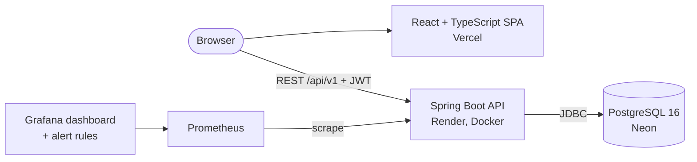
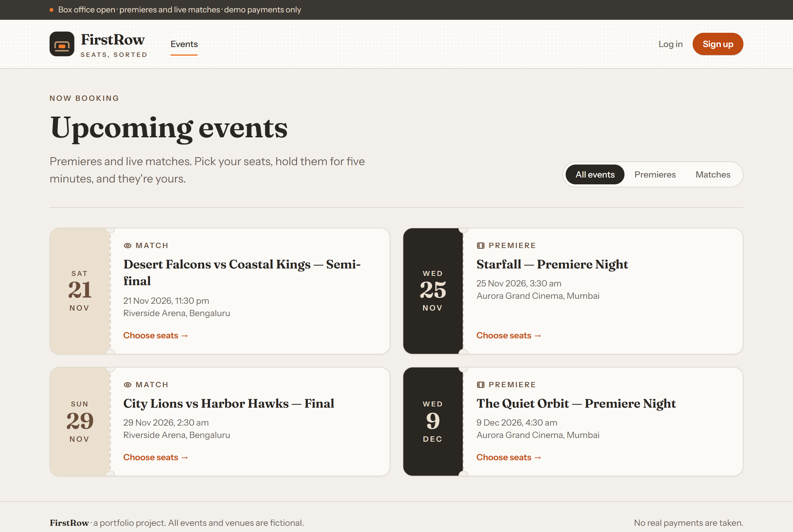
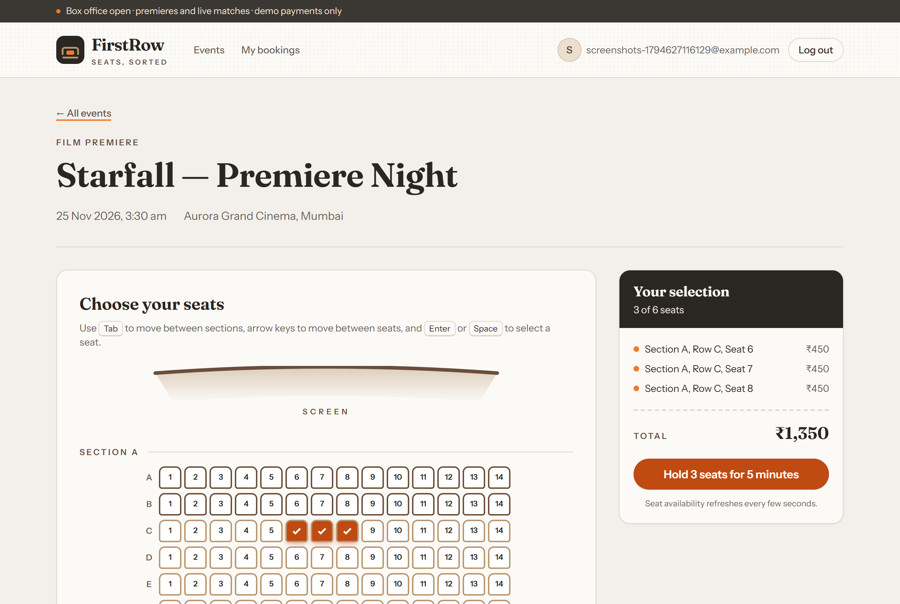
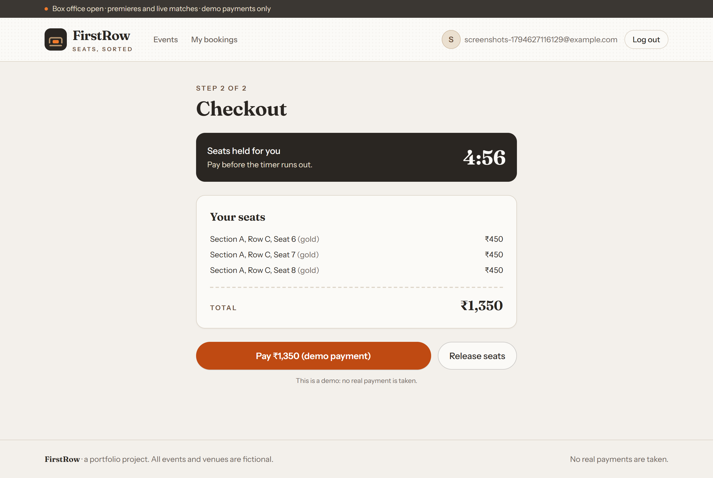
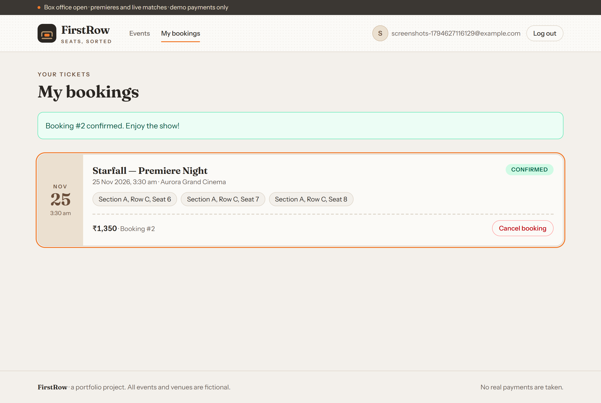

# FirstRow

**Seat booking for film premieres and live matches, built so that when hundreds of people click the same seat
at the same moment, exactly one gets it.** Users browse events, hold up to 6 seats for 5 minutes, and confirm
with a mock payment. Under the hood: one atomic conditional `UPDATE` in PostgreSQL instead of
check-then-write, idempotency keys so a retried payment can't book twice, lazy hold expiry that stays correct
even when the server is asleep, and tests that prove it, including a 50-thread race test and a 200-user k6
load test with **zero double bookings**.

Java 21 · Spring Boot 3.5 · PostgreSQL 16 · React 19 + TypeScript · Testcontainers · Docker · GitHub Actions ·
Prometheus + Grafana · k6

| | |
|---|---|
| Live demo | **https://first-row-book.vercel.app** |
| API | https://firstrow.onrender.com/api/v1/events |
| API docs (Swagger) | https://firstrow.onrender.com/swagger-ui.html |

> [!NOTE]
> **First visit may be slow.** The backend runs on a free hosting tier that goes to sleep after about 15 minutes
> without traffic. If the events list doesn't load straight away, the server is waking up: **please wait 1–2 minutes
> and refresh**. After that, everything responds normally.

## Architecture



More: [architecture & data model](docs/ARCHITECTURE.md) · [how concurrency is handled](docs/CONCURRENCY.md) ·
[API reference](docs/API.md) · [load test results](load-tests/RESULTS.md)

## Features

- **Events and seat maps:** paginated event list with filters; seat map with each seat's live status, refreshed every 3 s.
- **Seat holds:** up to 6 seats, all-or-nothing, for 5 minutes. A taken seat gives `409` listing exactly which seats.
- **Bookings:** mock payment, `Idempotency-Key` support (a retry returns the original booking), my bookings, cancel (frees the seats).
- **Auth:** signup/login with BCrypt and JWT; USER and ADMIN roles.
- **Admin:** create venues, and events from a layout spec (sections, rows, price tiers by row); seats inserted in one batch.
- **Accessible seat map:** every seat is a labelled button ("Section A, Row C, Seat 7, ₹450, available"), full keyboard support, icons and patterns as well as colour, screen-reader announcements.
- **Robustness:**
  - lazy hold expiry plus a cleanup job
  - rate limiting (10 holds/min/user, `429` + `Retry-After`)
  - RFC 7807 errors everywhere
  - database constraints as a second safety net
- **Observability:**
  - Micrometer metrics, request IDs in every log line and error
  - Grafana dashboard: requests/s, p95 latency, holds vs conflicts, bookings
  - two alert rules, unit-tested

## Run it locally (one command)

Requires Docker.

```bash
docker compose -f infra/docker-compose.yml up --build
```

| What | Where |
|---|---|
| App | http://localhost:5173 |
| API + Swagger UI | http://localhost:8080/swagger-ui.html |
| Admin login (local only) | `admin@firstrow.local` / `admin-password-123` |

Add `--profile observability` for Prometheus (http://localhost:9090) and Grafana (http://localhost:3000,
dashboard "FirstRow overview"). Flyway creates the schema and four demo events on first start; all names are
fictional.

## Screenshots

Taken from the live site.

**Upcoming events**: each event is a ticket, with filters for premieres and matches.



**Seat map**: live seat status, keyboard accessible, with up to 6 seats selected and a running total.



**Checkout**: the seats are held for 5 minutes while you pay (demo payment).



**My bookings**: confirmed bookings, which can be cancelled to free the seats.



## Tests

| Suite | What | Result |
|---|---|---|
| Backend (`./mvnw verify`) | 112 tests: JUnit 5 + Mockito unit tests, Spring Boot + **Testcontainers (real Postgres 16)** integration tests | all pass |
| Coverage (JaCoCo) | service layer / whole backend | **99.6%** / 98.0% of lines |
| Frontend (`npm test`) | 17 Vitest + Testing Library tests: seat statuses, keyboard operation, 409 handling, idempotency key reuse, hold expiry | all pass |
| Alert rules (`promtool test rules`) | rules fire on synthetic incidents, stay quiet on normal load | all pass |

Headline tests:

- **50 threads race for one seat**: exactly 1 hold, 49 × `409`, one hold row in the database.
- **40 overlapping multi-seat holds**: no seat shared between winners; losers hold nothing (all-or-nothing).
- **10 simultaneous confirms with the same `Idempotency-Key`**: exactly 1 booking, 9 replays.
- **Expired hold**: another user can hold its seats even though no cleanup job has run.

The concurrency tests were checked against a deliberately broken check-then-update implementation: they fail
(**10 winners for one seat**), so they really detect double booking.

CI (GitHub Actions) runs all of it on every push, plus frontend lint (with accessibility rules), Prometheus
config checks and the backend Docker build.

## Load test results

[k6](load-tests/rush.js): **200 virtual users rush a fresh 200-seat event**. Each grabs 1–4 random available
seats and pays, retrying after a 409. 3 runs, on one laptop (i5-13450HX) running everything in Docker.
Details: [load-tests/RESULTS.md](load-tests/RESULTS.md).

| Run | Hold attempts | Conflict rate | Hold p95 | Booking p95 | Failed requests | **Double-booked seats** |
|---|---|---|---|---|---|---|
| 1 (fresh JVM) | 227 | 57.7% | 216 ms | 195 ms | 0 | **0** |
| 2 | 215 | 55.3% | 110 ms | 104 ms | 0 | **0** |
| 3 | 216 | 56.0% | 88 ms | 89 ms | 0 | **0** |

- **Sold out:** every run sold all 200 seats in about 1 second.
- **No double bookings:** confirmed with [SQL checks](load-tests/verify.sql) after each run.
- **Cross-checked:** Prometheus counted exactly what k6 counted.

Reproduce:

```bash
docker compose -f infra/docker-compose.yml up -d --build
sh load-tests/run.sh
```

**Cold start on a Render-like container** (`--cpus=0.1 --memory=512m`, measured):

| Backend image | Cold start |
|---|---|
| Default JVM | 329 s |
| C1-only JIT + class-data-sharing archive | **114 s** |

## Repository layout

```
backend/     Spring Boot API (Java 21), Flyway migrations, tests
frontend/    React + TypeScript (Vite), Tailwind, Vitest
infra/       docker-compose, Prometheus config + alert rules (+ tests), Grafana provisioning + dashboard
load-tests/  k6 rush test, SQL correctness checks, measured results
docs/        ARCHITECTURE, CONCURRENCY, API, screenshots
```

## What I'd do next

- **Server-Sent Events** instead of 3 s polling, with Postgres `LISTEN/NOTIFY` to fan out across instances.
- **Lock ordering:** sort seat ids before the hold `UPDATE` to avoid most multi-seat deadlocks (today they're detected and returned as a retryable 409).
- **Real payments** with a transactional outbox and provider webhooks, so the database and the payment provider can never disagree.
- **Redis** for the rate limiter once there's more than one instance.
- **A virtual waiting room** for very large on-sales.
- **A `jlink`-trimmed JRE** for a smaller image, with a test that the TLS connection to Neon still works.
- **Playwright end-to-end tests** in CI, including an automated accessibility scan.
