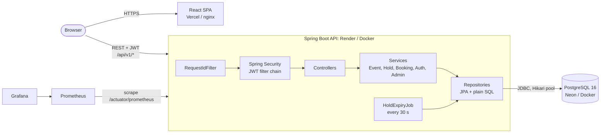
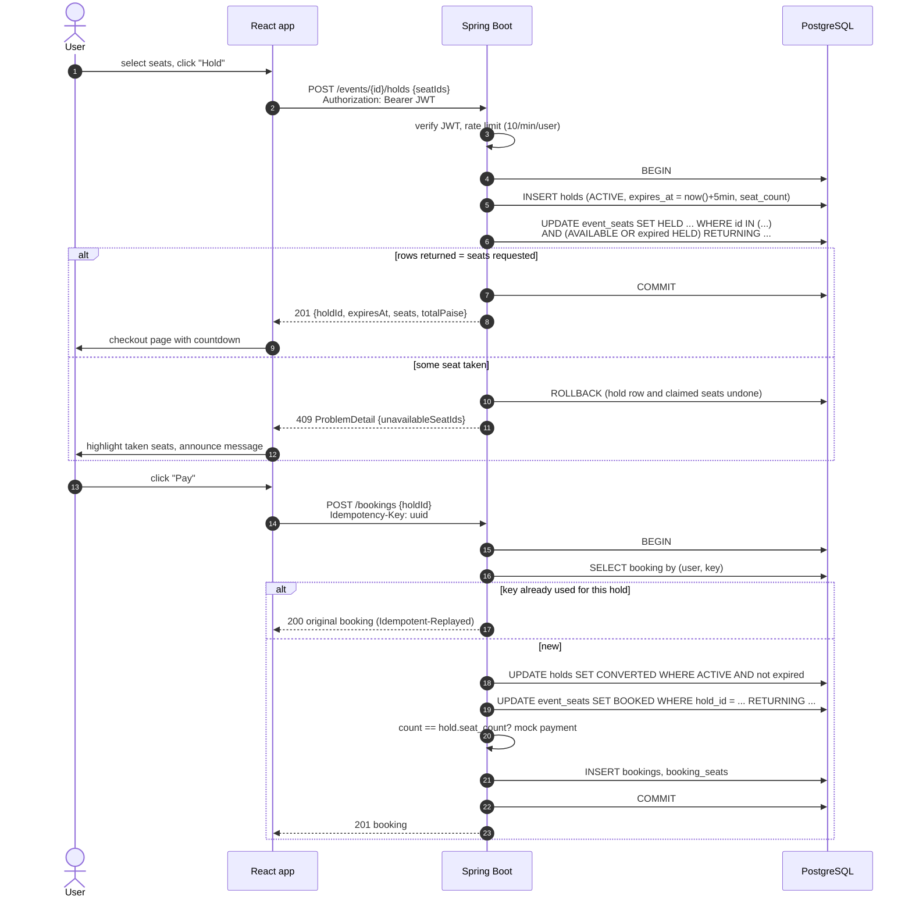
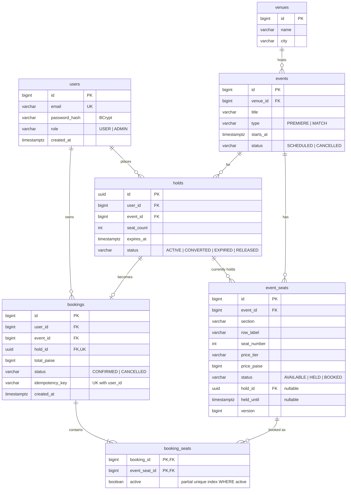

# Architecture

## Components



| Piece | Responsibility |
|---|---|
| **Frontend** (`frontend/`) | React + TypeScript SPA. TanStack Query caches API data and polls the seat map every 3 s. The JWT is kept in `localStorage`; the Idempotency-Key for each checkout in `sessionStorage`. |
| **RequestIdFilter** | Runs first. Gives each request an `X-Request-Id` (MDC → every log line, response header, error body). |
| **Spring Security** | Stateless. `BearerTokenAuthenticationFilter` verifies the HS256 JWT (signature, issuer, expiry) and maps the `role` claim to `ROLE_USER` / `ROLE_ADMIN`. Deny by default. |
| **Controllers** | HTTP only: validation (`@Valid`), status codes, headers. No business logic. |
| **Services** | Business rules and transaction boundaries (`@Transactional`). |
| **Repositories** | Spring Data JPA for simple entities (users, venues, events). **Plain SQL (`JdbcClient`)** for seats, holds and bookings, where the exact statement is the concurrency guarantee. |
| **HoldExpiryJob** | Housekeeping: marks expired holds and frees their seats. Correctness doesn't depend on it (lazy expiry). |
| **PostgreSQL** | Source of truth. Flyway migrations (`V1` schema, `V2` seed, `V3` hold seat count). Constraints are the last line of defence. |
| **Prometheus / Grafana** | Local `observability` profile: scrapes metrics, evaluates alert rules, shows the dashboard. |

### Package layout (backend)

```
com.firstrow
├── admin          create venues/events, SeatLayoutGenerator (layout spec -> seats)
├── auth           signup/login, TokenService (JWT), AdminBootstrap
├── booking        confirm / list / cancel, idempotency
├── common         ApiException, GlobalExceptionHandler (ProblemDetail), rate limiter, PageResponse
├── config         SecurityConfig, JwtConfig, CORS, OpenAPI, typed properties
├── event          events + seat map, lazy expiry SQL
├── hold           atomic hold UPDATE, release, expiry job
├── observability  RequestIdFilter, BookingMetrics
├── payment        PaymentGateway interface + MockPaymentGateway
├── user, venue    entities + repositories
```

Packages are by **feature**, not by layer, so one feature's code lives together.

## Request flow: hold → confirm



Why each step is safe under concurrency: [CONCURRENCY.md](CONCURRENCY.md).

## Data model



### Constraints and indexes, and why

| Object | Why |
|---|---|
| `UNIQUE (event_id, section, row_label, seat_number)` | A seat exists once per event. |
| `INDEX (event_id, status)` on `event_seats` | Seat map and hold UPDATE filter by event (and status). |
| `INDEX (hold_id)` on `event_seats` | Confirm/release find a hold's seats. |
| `CHECK chk_hold_fields` | A HELD seat must have `hold_id` and `held_until`; an AVAILABLE seat must have neither. Impossible states can't be stored. |
| `INDEX (status, expires_at)` on `holds` | Cleanup job finds ACTIVE holds past expiry. |
| `UNIQUE (user_id, event_id) WHERE status = 'ACTIVE'` on `holds` | One active hold per user per event, even with two tabs racing (see CONCURRENCY.md). |
| `version` on `events` | JPA `@Version`: an admin edit based on an old copy gets a 409 instead of overwriting. |
| `UNIQUE (user_id, idempotency_key)` on `bookings` | Final guard for idempotent confirm. |
| `UNIQUE (hold_id)` on `bookings` | One booking per hold, ever. |
| `UNIQUE (event_seat_id) WHERE active` on `booking_seats` | A seat is in at most one active booking (see CONCURRENCY.md). |
| `INDEX (user_id, created_at DESC)` on `bookings` | "My bookings", newest first. |
| `INDEX (type, starts_at)` and `(starts_at)` on `events` | Event list filtered by type and date, sorted by date. |

Money is always `BIGINT` paise: floating point can't represent 0.1 exactly, so rounding errors add up.

## Errors

Every error is RFC 7807 `application/problem+json`, including 401/403 from the security filters:

```json
{
  "type": "about:blank",
  "title": "Conflict",
  "status": 409,
  "detail": "Sorry, some of these seats were just taken by someone else.",
  "instance": "/api/v1/events/2/holds",
  "unavailableSeatIds": [13],
  "requestId": "4f0c2c1e-3b8a-4c5e-9d55-2a7f1c9e8b10"
}
```

## Observability

| Signal | Where |
|---|---|
| Metrics | `/actuator/prometheus`: `holds_granted_total`, `holds_conflicts_total`, `holds_expired_total`, `bookings_confirmed_total`, `bookings_cancelled_total`, `holds_create_seconds_*` (histogram), `http_server_requests_seconds_*` (histogram) |
| Logs | One `key=value` line per hold, conflict, booking, cancellation, each prefixed with `[rid=<request id>]` |
| Dashboard | Grafana "FirstRow overview": requests/s, p95 latency, holds vs conflicts, bookings over time, error rate |
| Alerts | `HighServerErrorRate` (>5% 5xx for 2 m), `HoldConflictSpike` (>80% conflicts for 1 m), unit-tested with `promtool` |
| Health | `/actuator/health` (+ `/liveness`, `/readiness`) |

The counter is `holds.granted`, not `holds.created`: in the OpenMetrics format `_created` is a reserved
suffix, and the Prometheus client silently exported `holds.created` as `holds_total`.
